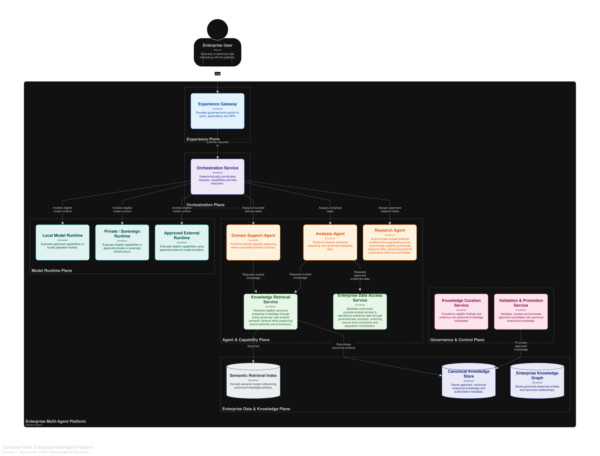

# Enterprise Multi-Agent Architecture

## Versions

This repository contains two published versions of the Enterprise Multi-Agent Architecture:

* Version 2 (current) — The extended reference architecture with explicit governance boundaries, probabilistic Context Need Assessment, governed knowledge lifecycles, and model execution trust policies.
* Version 1 (original) — The original reference architecture, preserved unchanged as a historical release.

Version 2 is maintained on the main branch. Version 1 remains accessible through its dedicated Git tag and GitHub release.

Each version retains its respective license.

A reference architecture for governed enterprise multi-agent systems that separates **agency, authority, knowledge, and model execution** instead of concentrating them in a central supervisor agent.

The architecture combines bounded autonomous reasoning with deterministic orchestration and explicit governance. Agents can reason, plan, use approved capabilities, and produce findings or work products — but they do not own enterprise state, grant themselves access, promote knowledge, or decide which model runtime may receive a particular payload.

## Why this architecture exists

Many multi-agent architectures focus primarily on how agents collaborate: a supervisor routes work to specialized agents, agents call tools, and model selection is treated as an implementation detail.

At enterprise scale, that is only part of the problem.

A production architecture also needs to answer:

- Who owns orchestration and task state?
- Which component is allowed to read, write, execute, or approve?
- What is authoritative enterprise knowledge, and what is merely a candidate or semantic index?
- How can external research extend knowledge without silently redefining enterprise truth?
- Which data representation may be disclosed to which model runtime?
- How are model capability and execution permission evaluated independently?
- How can autonomous reasoning coexist with deterministic governance and auditability?

This reference architecture treats these questions as first-class architectural concerns.

> **Autonomy belongs in reasoning. Authority belongs in the platform.**

## Architecture at a glance



The architecture is organized around a deterministic orchestration plane, a small set of bounded agent archetypes, governed access to enterprise data and knowledge, and an explicit trust path for model execution.

Three agent archetypes provide autonomous reasoning where it adds value:

- **Domain Support Agent** — performs domain-specific reasoning using approved knowledge, graph, and data capabilities.
- **Analysis Agent** — performs iterative analysis over governed enterprise data and produces analyses and evidence.
- **Research Agent** — investigates external sources when explicitly authorized for the task, producing findings and evidence rather than canonical enterprise knowledge.

Everything around those agents deliberately does not become an agent merely because an LLM could perform the task. Identity resolution, policy decisions, retrieval, data access, approvals, knowledge promotion, index maintenance, audit, and runtime eligibility remain explicit platform responsibilities.

The result is a system in which agents can be autonomous within a task without becoming authorities over enterprise state or governance.

## Core architectural principles

The architecture is built around a small number of deliberately strict boundaries:

- **Orchestration ≠ Intelligence.** Routing, lifecycle management, policy enforcement, and task coordination remain deterministic platform responsibilities.
- **Agent ≠ Runtime.** An agent defines bounded agency and capabilities; the model providing cognition is an exchangeable runtime.
- **Routing ≠ Model Selection.** The platform first determines what needs to happen and only then which eligible runtime may execute the required capability.
- **Retrieval ≠ Research.** Retrieval accesses governed enterprise knowledge. Research crosses an external trust boundary and produces findings that require curation before they can become enterprise knowledge.
- **Vector Index ≠ Source of Truth.** Semantic indexes locate knowledge; canonical stores remain authoritative.
- **Agents propose; policy promotes.** Agents may create findings, evidence, analyses, and action requests, but they do not directly mutate canonical enterprise state.
- **Authorization travels with the request.** Delegating work to another agent or capability never implies privilege escalation.
- **Assessment ≠ Authorization.** Probabilistic Context Need Assessment estimates whether additional context may be useful; deterministic policy authorizes acquisition, and orchestration coordinates its execution.
- **Policy says what MAY; evaluation says what CAN.** Runtime permission and runtime capability are evaluated independently before execution.

These boundaries allow autonomous reasoning without transferring governance authority to autonomous components.

## Architecture views

The architecture is modeled as one coherent system with six complementary views. Each view answers a different architectural question without introducing a separate architecture.

| View | Architectural question | Diagram |
|---|---|---|
| **1. System Context** | Who interacts with the platform, and which enterprise or external systems define its environment? | [Open diagram](diagrams/01-system-context.svg) |
| **2. Architecture Overview** | How do orchestration, agents, governed data access, knowledge, and model runtimes fit together at a high level? | [Open diagram](diagrams/02-architecture-overview.svg) |
| **3. Orchestration & Agent Plane** | How are requests governed, delegated to bounded agents, persisted as tasks, and translated into approved actions? | [Open diagram](diagrams/03-orchestration-agent-plane.svg) |
| **4. Enterprise Data & Knowledge Plane** | Where does enterprise state live, which stores are authoritative, and which representations are derived? | [Open diagram](diagrams/04-enterprise-data-knowledge-plane.svg) |
| **5. Knowledge Lifecycle** | How can new findings become governed enterprise knowledge without allowing agents to modify canonical state directly? | [Open diagram](diagrams/05-knowledge-lifecycle.svg) |
| **6. Model Execution & Trust Policy** | How is a payload classified, transformed, validated, and matched to an eligible and capable model runtime? | [Open diagram](diagrams/06-model-execution-trust-policy.svg) |

> **We do not build six architectures. We model one architecture through six views.**

## Reference flows

The architecture can be understood through three representative execution paths.

### 1. Governed enterprise knowledge

A user question is classified and scoped by the orchestration plane. A Domain Support Agent can combine governed knowledge retrieval with relationship information from the Enterprise Knowledge Graph. Retrieved artifacts remain grounded in canonical enterprise knowledge.

### 2. Governed enterprise analysis

An Analysis Agent may iteratively request data required for its task, but it does not receive unrestricted database access. The Enterprise Data Access Service mediates access to approved operational sources under the identity, policy, and classification context of the request.

> **The agent decides what it needs to know. The data access layer decides what it is allowed to know.**

### 3. Research and knowledge promotion

External research is a separate, explicitly authorized acquisition capability. Insufficient enterprise knowledge does not automatically trigger research. The Research Agent produces findings and evidence rather than canonical knowledge.

New knowledge follows a governed lifecycle:

**Finding → Curation → Candidate → Validation / Review → Promotion → Canonical Knowledge**

Derived semantic indexes and governed graph relationships are updated only after promotion through their respective lifecycle services.

> **Research may extend what the system knows. It may never redefine what the enterprise considers true by itself.**

## Repository structure

```text
.
├── README.md
├── LICENSE
├── ARCHITECTURE_RATIONALE.md
├── architecture/
│   ├── workspace.dsl
│   └── workspace.json
└── diagrams/
    ├── 01-system-context.svg
    ├── 02-architecture-overview.svg
    ├── 03-orchestration-agent-plane.svg
    ├── 04-enterprise-data-knowledge-plane.svg
    ├── 05-knowledge-lifecycle.svg
    └── 06-model-execution-trust-policy.svg
```

The architecture is maintained as a Structurizr model rather than as a collection of independently edited diagrams.

- **`architecture/workspace.dsl`** is the semantic source of truth for the architecture: systems, containers, relationships, views, and architectural structure.

- **`architecture/workspace.json`** contains the serialized Structurizr workspace and layout state. It is versioned to preserve the workspace representation, but it is not the semantic source of truth.

- **`diagrams/`** contains exported publication artifacts generated from the architecture model.

The exported diagrams are intended to make the architecture directly accessible on GitHub without requiring Structurizr or a local runtime.

## Architecture rationale

The diagrams show how the architecture is structured. The deeper reasoning behind its boundaries, rejected alternatives, and trade-offs is documented in [`ARCHITECTURE_RATIONALE.md`](ARCHITECTURE_RATIONALE.md).

It explains why orchestration remains deterministic, why only selected capabilities become agents, how enterprise knowledge and operational data are governed, how model execution crosses explicit trust boundaries, and which architectural shortcuts were deliberately rejected.

## Acknowledgements

This architecture was developed by **Vadim Ott** through an iterative design and review process with **Aelio**, his AI sparring partner powered by ChatGPT.

Aelio contributed to architectural exploration, critical review, alternative evaluation, and the refinement of design principles and documentation. Final architectural decisions, validation, and responsibility for the published work remain with the human author.

## License

Version 2 of the Enterprise Multi-Agent Architecture is published under the Research & Evaluation License (REAL), Version 1.0.

The license permits public reading, personal study, and non-commercial academic research, including qualifying research prototypes, subject to its terms and attribution requirements.

Commercial use of the protected architecture materials requires prior written permission from the copyright holder.

The original Version 1 remains available under the Creative Commons Attribution 4.0 International License (CC BY 4.0) through its historical release.

The licensing terms of Version 2 do not retroactively alter the license granted for Version 1.

See [LICENSE](LICENSE) for the complete terms applicable to Version 2.

For licensing inquiries: architecture.licensing@vadim-ott.de